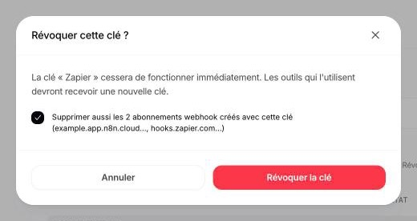

## API keys

An API key — `agk_live_` followed by 32 characters — gives access to the **whole workspace**: its automations, leads, runs and webhook subscriptions. There are no per-key permissions in v1, and no test keys: every key is live.

Agentova stores only a fingerprint of each key. A key is shown once, at creation, and can't be displayed again: if it's lost, create a new one.

### Storing a key

- Keep it on a server: in a secret manager or an environment variable. Never in source code, a repository, a URL or a log.
- Never put it in a web page or a mobile app. The API doesn't accept calls from browsers (no CORS), and anything shipped to a device can be read.
- Send it only in the `Authorization: Bearer` header, to `https://api.agentova.ai/v1`.
- Create one key per tool or integration (“Zapier”, “n8n”, “CRM sync”…), so you can revoke one without breaking the others.

### Rotating a key

A workspace can have up to 10 active keys, so a key can be replaced without interruption:

1. Create a new key in **Paramètres → API** (Settings → API).
2. Put it everywhere the old key is used: reconnect the account in Zapier, update the credential in n8n, update your servers.
3. Revoke the old key. To keep the triggers registered with it running, untick the box that deletes its webhook subscriptions — see below.

### Revoking a key

A revoked key stops working immediately: every call made with it is refused with `401 invalid_api_key`.

When you click **Révoquer** (Revoke) on a key, the confirmation window **Révoquer cette clé ?** has a box ticked by default when webhook subscriptions were created with that key: **Supprimer aussi les abonnements webhook créés avec cette clé** (Also delete the webhook subscriptions created with this key); its wording gives their number and the servers they point to.

<Frame caption="Revoking a key: the box is ticked by default">
  
</Frame>

- **Box ticked** (the default): the subscriptions are deleted together with the key. A key that leaked may have subscribed someone else's server: from then on, it receives nothing. The Zaps and n8n workflows that used those subscriptions stop receiving events; once they use a new key, turn the Zap off and on, or deactivate and reactivate the workflow, to register again.
- **Box unticked**: the subscriptions are kept and keep receiving your workspace's events. Use it to rotate a key without interrupting your triggers.

Workspace admins see every subscription in the **Abonnements webhook** table of **Paramètres → API**, with the key that created it, and can delete it there.

<Warning>
  If a key may have leaked: revoke it with the box ticked, then check the **Abonnements webhook** table in **Paramètres → API** and delete the subscriptions you don't recognize.
</Warning>

### When an admin leaves

Only admins can create keys. When the admin who created a key leaves the workspace, is removed from it, deletes their account or stops being an admin, their active keys are revoked automatically, together with the webhook subscriptions created with them, and the remaining admins are notified. If an integration stops with `401 invalid_api_key` after such a change, create a new key and reconnect it.

## Webhooks

- Every delivery is signed with the subscription's secret (`whsec_…`, shown once, at creation). Verify the signature of every delivery, and reject deliveries signed more than 5 minutes ago — see [Verifying the signature](/en/guides/webhooks-and-signatures#verifying-the-signature).
- Authenticate deliveries with the signature. Not by IP address — Agentova doesn't publish a list of source addresses — and not by their `User-Agent: Agentova-Webhooks/1.0` header, which anyone can send: it's only there to help you recognize deliveries in your logs.
- Deliveries only go to public HTTPS addresses, and redirects are never followed. A subscription whose URL no longer passes these address checks — for example an IP address that has become forbidden — is disabled at once, without any delivery, and the workspace admins are notified.
- To change a subscription's secret, create a new subscription, switch your endpoint to the new secret, then delete the old subscription. While both exist, the same event reaches both, with the same `id`: deduplicate on it.

## Calls from a browser

The API is server-to-server. It doesn't send CORS headers, and a browser's preflight (`OPTIONS`) request gets an error in the usual format. Call the API from your backend, and keep the key there.

## Trying the API from this portal

The playground of the **API Reference** tab sends your requests through the proxy of Mintlify, the service that hosts this portal, since the API doesn't accept calls from browsers. The key you paste there goes through that proxy. Prefer a key created for the occasion, in a test workspace, and revoke it afterwards.

## Data retention

| Data | Kept for |
|---|---|
| Runs | 90 days, then deleted |
| Webhook delivery log | 30 days, then deleted |
| Disabled webhook subscriptions | 30 days after being disabled, then deleted |

Keys starting with `_` in a lead's `custom_fields` are internal to Agentova and are never exposed by the API.

## Reporting a vulnerability

Write to [contact@agentova.ai](mailto:contact@agentova.ai) with what's needed to reproduce the problem. Never include a real API key or webhook secret: describe the problem, or use a key that you revoke right after.
