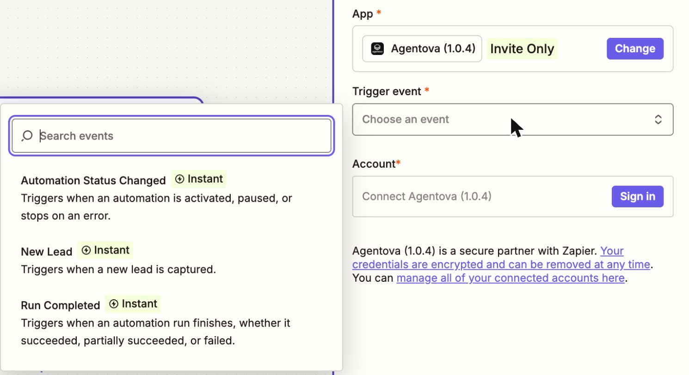
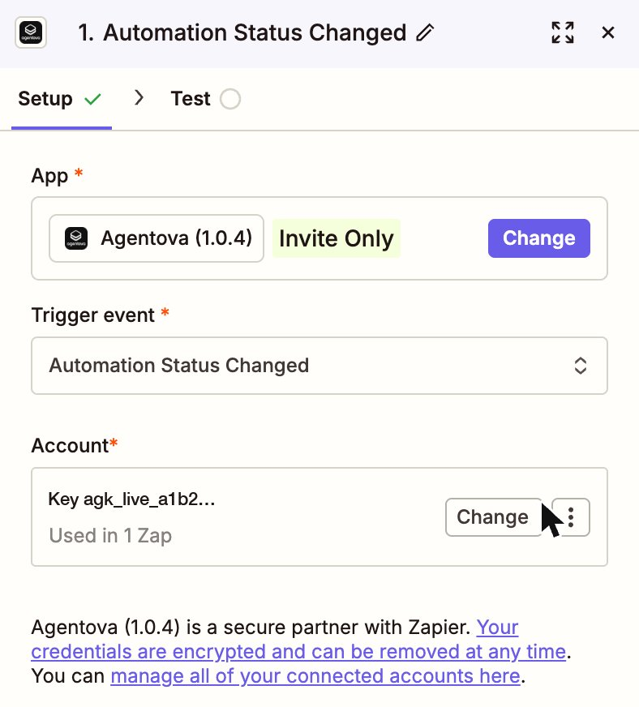
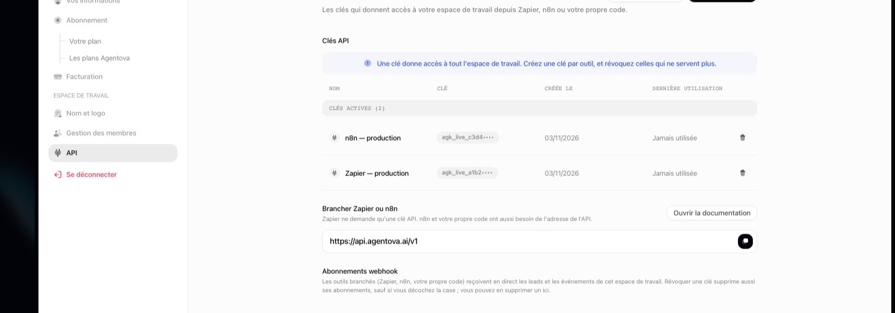

import ApiKey from "/snippets/en/api-key.mdx";

## 1. Create an API key in Agentova

<ApiKey />

## 2. Connect it in Zapier

<Steps>
  <Step title="Accept the invitation (while the app is invite-only)">
    Open the invitation link Agentova sent you, while signed in to the Zapier account you'll use, and accept it. Without this step, the Agentova app doesn't show up in the Zap editor. Once the app is public, skip this step.
  </Step>
  <Step title="Add an Agentova step to a Zap">
    In the Zap editor, add a trigger or an action and search for **Agentova**. Pick the event you want.

    <Frame caption="The Agentova app in the Zap editor: its three instant triggers and the Sign in button">
      
    </Frame>

  </Step>
  <Step title="Sign in">
    Click **Sign in** (or **Connect a new account**) and paste your key in the **API key** field.
  </Step>
  <Step title="Check the connection">
    Zapier tests the key right away. When it works, the account is labeled with the beginning of its key — for example **Key agk_live_a1b2…** — the same beginning Agentova shows in **Paramètres → API**. That's how you know which key each Zapier account uses, for example before revoking one.

    <Frame caption="The connected account, labeled with the beginning of its key">
      
    </Frame>

    <Frame caption="Paramètres → API shows the beginning of each key: the same one Zapier uses to label the connected account">
      
    </Frame>

  </Step>
</Steps>

<Tip>
  One key = one workspace. To work with several Agentova workspaces, connect one account per workspace, each with its own key.
</Tip>

## If the connection fails

| Message | What it means | What to do |
|---|---|---|
| “Invalid or revoked API key…” | The key is wrong, incomplete, or was revoked | Copy the key again, or create a new one |
| “Your Agentova subscription doesn't currently allow API access…” | The workspace's subscription is unpaid, paused or incomplete | Fix the subscription in **Paramètres → Abonnement** (the plan) or **Paramètres → Facturation** (payment method, invoices) |

## When you revoke a key

The Agentova **actions and searches** that use the key stop: Zapier marks the account as expired, emails you, and holds those Zap runs until you reconnect the account with a new key.

The Agentova **triggers** depend on the box ticked by default in the **Révoquer cette clé ?** window, which deletes the webhook subscriptions created with the key:

- **Box ticked** (the default): the Zaps' registrations are deleted with the key, and their triggers stop receiving events. Once the account is reconnected with a new key, **turn each Zap off and on** to register again.
- **Box unticked**: the triggers keep receiving events, as long as the admin who created the old key remains an admin of the workspace. To stop depending on it, turn each Zap off and on once the account is reconnected with the new key. To stop them later, turn their Zaps off, or delete their subscriptions in the **Abonnements webhook** table of **Paramètres → API**.

See [Revoking a key](/en/security#revoking-a-key).
