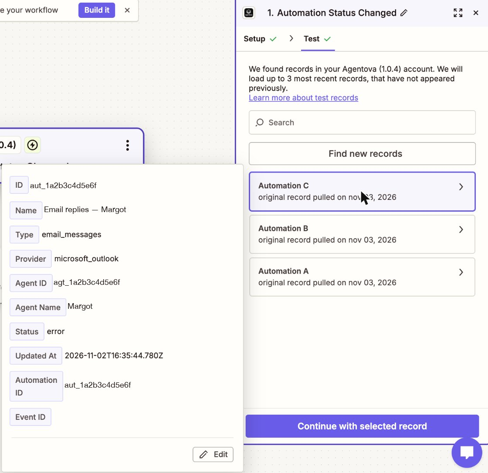

import Events from "/snippets/en/events.mdx";
import LeadSources from "/snippets/en/lead-sources.mdx";
import CoveredAutomations from "/snippets/en/covered-automations.mdx";
import RunsByChannel from "/snippets/en/runs-by-channel.mdx";

| Trigger in Zapier | Event |
|---|---|
| **New Lead** | Lead created |
| **Run Completed** | Run completed |
| **Automation Status Changed** | Automation status changed |

<Info>
  There is no webhook to set up by hand. In the Zap editor, pick the **Agentova** app, then one of these triggers in the list of events. When you publish the Zap, Zapier subscribes to Agentova by itself: the subscription shows up in the **Abonnements webhook** table of **Paramètres → API**, with the key of the connected account. Turning the Zap off deletes it.
</Info>

<Events />

Every trigger fires for **the whole workspace**: all its leads, all its covered automations. To keep only some of them, add a **Filter by Zapier** step right after the trigger (see [Ready-made Zaps](/en/zapier/recipes)).

## New Lead

Fires once per new lead, a few seconds after it's saved in Agentova.

<LeadSources />

**Fields you can use in later steps:** ID (the lead's ID), Event ID, Source, Agent ID, Name, Email, Phone, Custom fields, Created At. Name, email and phone can be empty, depending on what the prospect gave. Lead ID repeats the ID, for Zaps built with an earlier version of the app.

## Run Completed

Fires each time one of your automations has actually done something.

<RunsByChannel />

**Fields you can use:** ID (the run's ID), Event ID, Automation ID, Status (`success`, `partial`, `failed`), Trigger Type, Occurred At, Actions (each with its Action Type, and its Action Status: `success` or `failed`), and Lead ID for Lead Ads and CRM runs. Run ID repeats the ID, for Zaps built with an earlier version of the app.

## Automation Status Changed

Fires when an automation's status really changes, from the Agentova app or from the API — including your own Zaps: it's paused or reactivated, it stops on an error, or it comes back after its account is reconnected.

These automations are covered:

<CoveredAutomations />

**Fields you can use:** ID (the automation's ID), Event ID, Name, Type, Provider, Agent ID, Agent Name, Status (`active`, `paused`, `draft`, `error`), Updated At. Automation ID repeats the ID, for Zaps built with an earlier version of the app.

<Note>
  Pausing an automation that's already paused doesn't fire this trigger: nothing changed. Deleting an automation or turning it off in the Agentova app doesn't fire it either.
</Note>

## Testing a trigger

When you click **Test trigger**, Zapier shows your most recent real items as samples: your latest leads, runs or automations. **Event ID** is empty in these samples: it's only set on real events. An empty workspace shows “No … found” — that's not an error. **Run Completed** stays empty until one of your automations has run at least once.

<Frame caption="Test trigger on Automation Status Changed: your three most recent automations as samples, Event ID empty">
  
</Frame>

## How instant triggers work

When you **publish** a Zap, Zapier registers with Agentova to be notified of that event. When you turn the Zap off or delete it, that registration is removed. You don't have to manage anything.

- **Signed notifications.** Every notification is signed by Agentova. The app checks the signature, and ignores a notification that is unsigned, forged, or signed more than an hour ago. An ignored notification shows as **Halted** in the Zap's history.
- **No duplicates.** After a network problem, Agentova can send the same event again. The app recognizes an event it already delivered to this Zap during the last 48 hours, and stops that run (**Halted**, “Ignored a repeated delivery…”), so your Zap doesn't run twice.
- **No guaranteed order.** Two events can reach your Zap in any order. To know the latest status of an automation, compare **Updated At**.
- **While Agentova's API is switched off.** Agentova can switch its API off for a while. The events that happen during such a break are never delivered to your Zap.
- **After a long outage.** If Zapier can't be reached, Agentova retries each notification up to 8 times over about 27 and a half hours. Once three notifications in a row have been abandoned **and** deliveries have been failing for at least 72 hours, Agentova stops notifying that Zap and alerts your workspace admins. To start again, **turn the Zap off and on**.
