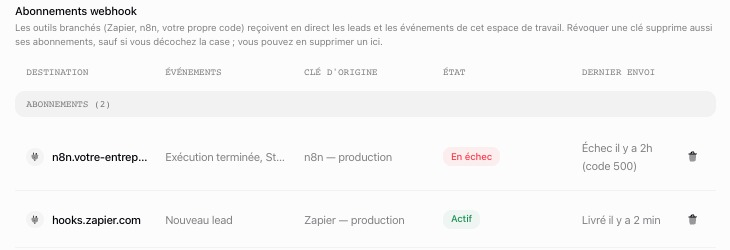

import Events from "/snippets/events.mdx";

## Événements

La v1 compte trois événements :

<Events />

Voir [Concepts](/guides/concepts) pour les sources de leads et les exécutions produites par chaque canal.

## S'abonner

`POST /webhooks` avec une `url` et les `events` voulus (au moins un). La réponse contient un `secret` — affiché **une seule fois**, à la création. Conservez-le : c'est lui qui vous sert à vérifier chaque livraison de cet abonnement. Chaque abonnement a son propre secret.

L'`url` doit :

- utiliser **HTTPS** ;
- pointer vers une adresse publique — les adresses locales, privées et de métadonnées cloud sont refusées, et le nom d'hôte doit se résoudre ;
- ne contenir ni nom d'utilisateur ni mot de passe.

Une URL refusée renvoie `400 invalid_request` avec `details.parameter: "url"` et une `details.reason` (`https_required`, `private_address`, `local_address`, `credentials_in_url`, `unresolvable_host`…).

Un espace de travail peut avoir **20 abonnements actifs**. `GET /webhooks` les renvoie tous d'un coup, sans pagination — avec les abonnements désactivés, jusqu'à leur suppression (voir [plus bas](#quand-un-abonnement-est-désactivé)). Elle ne renvoie l'`url` complète que pour les abonnements créés avec la clé qui fait l'appel ; pour les autres, `url` est réduite à son origine (par exemple `https://hooks.zapier.com`), car le chemin d'une adresse de webhook contient le jeton secret du connecteur.

Les abonnements appartiennent à l'**espace de travail** : n'importe quelle clé de l'espace de travail peut les lister et les supprimer. Révoquer une clé supprime les abonnements créés avec elle, sauf si l'administrateur choisit de les garder — voir [Révoquer une clé](/security#révoquer-une-clé). Les administrateurs de l'espace de travail voient et peuvent supprimer tous les abonnements dans le tableau **Abonnements webhook** de **Paramètres → API**.

<Frame caption="Abonnements webhook : une ligne par abonnement, avec la clé qui l'a créé">
  
</Frame>

## La livraison

Chaque événement est livré par un `POST` à l'URL de l'abonnement, avec ces en-têtes :

| En-tête | Valeur |
|---|---|
| `Content-Type` | `application/json` |
| `User-Agent` | `Agentova-Webhooks/1.0` |
| `X-Agentova-Signature` | La signature — voir [plus bas](#vérifier-la-signature) |

Le corps est une enveloppe JSON :

```json
{
  "id": "evt_example345",
  "type": "lead.created",
  "created_at": "2026-10-01T09:20:01Z",
  "data": {
    "id": "lea_example678",
    "source": "lead_ads",
    "agent_id": "agt_example456",
    "name": "Jane Doe",
    "email": "jane.doe@example.com",
    "phone": "+33 6 12 34 56 78",
    "custom_fields": { "budget": "5000-10000" },
    "created_at": "2026-10-01T09:20:00Z"
  }
}
```

La forme de `data` dépend de `type` : un lead pour `lead.created`, une exécution pour `run.completed`, une automatisation pour `automation.status_changed` — les mêmes objets que ceux renvoyés par `GET /leads`, `GET /runs` et `GET /automations`.

- **Au moins une fois.** Un même événement peut être livré plusieurs fois, après un nouvel essai par exemple. Dédoublonnez sur `id` : il est unique par événement, identique à chaque tentative, et le même pour tous les abonnements qui reçoivent l'événement. Gardez les identifiants déjà vus pendant **au moins 48 heures** : les nouveaux essais sont toujours programmés dans les 36 heures qui suivent la création de l'événement.
- **Sans ordre garanti.** Deux événements peuvent arriver dans n'importe quel ordre — une pause et la réactivation qui la suit, par exemple. Pour les ordonner, utilisez l'horodatage de la ressource elle-même — `updated_at` pour une automatisation, `created_at` pour un lead, `occurred_at` pour une exécution —, pas l'ordre d'arrivée.

## Vérifier la signature

Chaque livraison porte un en-tête `X-Agentova-Signature` :

```
X-Agentova-Signature: t=1790856000,v1=cc0aeaeeb19b6d50d7c200ece4653adfba91c3a9f6cb2223ca61cd3965bf55ee
```

- `t` — le moment où cette tentative de livraison a été signée, en horodatage Unix (secondes)
- `v1` — le HMAC-SHA256 de la chaîne `{t}.{corps brut}`, en hexadécimal minuscule

La clé du HMAC est le secret de votre abonnement **pris en entier, préfixe `whsec_` compris**. Certaines bibliothèques de webhooks — celles qui suivent la convention Standard Webhooks — retirent un préfixe `whsec_` et décodent ce qui suit : ne les utilisez pas telles quelles. Chez Agentova, le préfixe fait partie de la clé.

C'est la signature qui authentifie une livraison. Ne filtrez pas les livraisons par adresse IP ni par `User-Agent` : Agentova ne publie pas de liste d'adresses d'origine, et n'importe qui peut envoyer ce `User-Agent`.

Pour vérifier une livraison :

1. Lisez le corps **brut**, exactement tel que reçu, avant toute analyse JSON — un corps analysé puis resérialisé ne produit pas les mêmes octets.
2. Rejetez-la si `t` s'écarte de plus de **5 minutes** de votre heure actuelle. Cela bloque les requêtes rejouées.
3. Calculez le HMAC-SHA256 de `{t}.{corps brut}` avec le secret complet, et comparez-le à `v1` en **temps constant** — jamais avec `==` ou `===`, qui laissent fuiter des informations de temps.

<CodeGroup>

```js Node.js
import { createHmac, timingSafeEqual } from "node:crypto";

const TOLERANCE_SECONDS = 5 * 60;

// rawBody : le corps de la requête exactement tel que reçu (Buffer ou chaîne), avant
//           toute analyse JSON. Avec Express : express.raw({ type: "application/json" }).
// header :  la valeur de l'en-tête X-Agentova-Signature.
// secret :  le secret complet de l'abonnement, préfixe "whsec_" compris.
export function isValidAgentovaSignature(rawBody, header, secret, now = Date.now() / 1000) {
  if (typeof header !== "string") return false;
  const parts = {};
  for (const item of header.split(",")) {
    const [key, ...value] = item.trim().split("=");
    parts[key] = value.join("=");
  }
  const { t, v1 } = parts;
  if (!/^\d+$/.test(t ?? "") || !/^[0-9a-f]{64}$/.test(v1 ?? "")) return false;
  if (Math.abs(now - Number(t)) > TOLERANCE_SECONDS) return false;
  const expected = createHmac("sha256", secret).update(`${t}.`).update(rawBody).digest();
  return timingSafeEqual(expected, Buffer.from(v1, "hex"));
}
```

```python Python
import hashlib
import hmac
import re
import time

TOLERANCE_SECONDS = 5 * 60


def is_valid_agentova_signature(raw_body, header, secret, now=None):
    """raw_body : le corps de la requête exactement tel que reçu (bytes), avant toute
    analyse JSON. Avec Flask : request.get_data() ; avec Django : request.body.
    header : la valeur de l'en-tête X-Agentova-Signature.
    secret : le secret complet de l'abonnement, préfixe "whsec_" compris."""
    if not header:
        return False
    parts = dict(item.strip().split("=", 1) for item in header.split(",") if "=" in item)
    t, v1 = parts.get("t", ""), parts.get("v1", "")
    if not re.fullmatch(r"[0-9]+", t) or not re.fullmatch(r"[0-9a-f]{64}", v1):
        return False
    if abs((time.time() if now is None else now) - int(t)) > TOLERANCE_SECONDS:
        return False
    expected = hmac.new(secret.encode(), t.encode() + b"." + raw_body, hashlib.sha256).hexdigest()
    return hmac.compare_digest(expected, v1)
```

```php PHP
<?php

const AGENTOVA_TOLERANCE_SECONDS = 300;

/**
 * $rawBody : le corps de la requête exactement tel que reçu : file_get_contents('php://input'),
 *            ou $request->getContent() avec Laravel.
 * $header :  l'en-tête X-Agentova-Signature : $_SERVER['HTTP_X_AGENTOVA_SIGNATURE'] ?? null.
 * $secret :  le secret complet de l'abonnement, préfixe "whsec_" compris.
 */
function is_valid_agentova_signature(string $rawBody, ?string $header, string $secret, ?int $now = null): bool
{
    if ($header === null) {
        return false;
    }
    $parts = [];
    foreach (explode(',', $header) as $item) {
        $pair = explode('=', trim($item), 2);
        if (count($pair) === 2) {
            $parts[$pair[0]] = $pair[1];
        }
    }
    $t = $parts['t'] ?? '';
    $v1 = $parts['v1'] ?? '';
    if (!ctype_digit($t) || strlen($v1) !== 64 || !ctype_xdigit($v1)) {
        return false;
    }
    if (abs(($now ?? time()) - (int) $t) > AGENTOVA_TOLERANCE_SECONDS) {
        return false;
    }
    return hash_equals(hash_hmac('sha256', $t . '.' . $rawBody, $secret), $v1);
}
```

</CodeGroup>

<Note>
  Les connecteurs officiels vérifient les signatures pour vous : avec le nœud n8n ou l'app Zapier, cette section ne vous concerne pas. L'app Zapier accepte des signatures vieilles d'une heure au plus, car Zapier peut traiter une notification avec du retard et son adresse de notification est déjà secrète. Pour votre propre route, gardez 5 minutes.
</Note>

### Vecteur de test

Vérifiez votre implémentation avec ces valeurs avant la mise en service :

| Entrée | Valeur |
|---|---|
| Secret | `whsec_0123456789abcdef0123456789abcdef` |
| Horodatage `t` | `1790856000` |
| Corps brut | ci-dessous : 333 octets d'UTF-8, sur une seule ligne, sans retour à la ligne final |

```json Corps brut
{"id":"evt_example0001","type":"automation.status_changed","created_at":"2026-10-01T12:00:00Z","data":{"id":"aut_example123","name":"Comment replies — Support Agent","type":"social_comments","provider":"instagram_page","agent_id":"agt_example456","agent_name":"Support Agent","status":"paused","updated_at":"2026-10-01T12:00:00Z"}}
```

En-tête attendu :

```
X-Agentova-Signature: t=1790856000,v1=cc0aeaeeb19b6d50d7c200ece4653adfba91c3a9f6cb2223ca61cd3965bf55ee
```

Avec ces entrées et l'heure actuelle fixée à `1790856000`, votre fonction doit renvoyer `true`. Elle doit renvoyer `false` quand un caractère du corps change, quand l'heure actuelle s'écarte de plus de 300 secondes de `t`, et quand le secret est utilisé sans son préfixe `whsec_`.

| Si vous obtenez `v1` = | Vous avez probablement |
|---|---|
| `2150ccec9089a1d677a2d02d01376a6df64ca89af12b341ba35695d33e2fc261` | retiré le préfixe `whsec_` du secret |
| `5c093661d42f63c53b0fb8ec6b2ec76d873cd350c59a9ea436493f72ca477adb` | ajouté un retour à la ligne à la fin du corps |

<Accordion title="Reproduire le vecteur depuis un terminal">
  ```bash
  printf '%s.%s' 1790856000 '{"id":"evt_example0001","type":"automation.status_changed","created_at":"2026-10-01T12:00:00Z","data":{"id":"aut_example123","name":"Comment replies — Support Agent","type":"social_comments","provider":"instagram_page","agent_id":"agt_example456","agent_name":"Support Agent","status":"paused","updated_at":"2026-10-01T12:00:00Z"}}' \
    | openssl dgst -sha256 -hmac 'whsec_0123456789abcdef0123456789abcdef'
  ```

  La sortie se termine par `cc0aeaeeb19b6d50d7c200ece4653adfba91c3a9f6cb2223ca61cd3965bf55ee`.
</Accordion>

## Répondre à une livraison

Agentova considère une livraison comme réussie quand votre route répond par un **statut 2xx en moins de 10 secondes** — l'échange complet, pas seulement le premier octet. Le corps de votre réponse est ignoré.

Tout le reste est une tentative échouée : un autre statut, un délai dépassé, une erreur de connexion — et aussi tout **3xx** : les redirections ne sont jamais suivies, abonnez donc l'URL finale.

Deux réponses ont un sens particulier :

| Votre route répond | Ce que fait Agentova |
|---|---|
| `410 Gone` | Supprime l'abonnement immédiatement, sans prévenir personne. Utilisez-la pour dire « cette adresse n'existe plus, définitivement ». |
| `429` ou `503` avec un en-tête `Retry-After` | Attend au moins ce délai avant la tentative suivante, jusqu'à 12 heures — sauf si cela repousse la tentative suivante à plus de 36 heures après la création de l'événement : la livraison est alors abandonnée. |

## Nouveaux essais

Une livraison échouée est retentée, pour **8 tentatives** au total sur environ 27 heures et demie :

| Tentative | Envoyée |
|---|---|
| 1 | Immédiatement |
| 2 | 5 secondes après la première |
| 3 | 5 minutes après la deuxième |
| 4 | 30 minutes après la troisième |
| 5 | 2 heures après la quatrième |
| 6 | 5 heures après la cinquième |
| 7 | 10 heures après la sixième |
| 8 | 10 heures après la septième |

Chaque tentative porte le **même `id` d'événement**, avec une nouvelle signature (un nouveau `t`). Après la 8ᵉ tentative échouée, la livraison est abandonnée. Un `Retry-After` peut repousser une tentative au-delà de ce calendrier, mais aucune tentative n'est jamais programmée plus de **36 heures** après la création de l'événement : quand la suivante le serait, la livraison est abandonnée.

## Quand un abonnement est désactivé

Quand une livraison est abandonnée, Agentova **désactive** l'abonnement si les deux conditions sont réunies :

- l'abonnement compte au moins **3 livraisons abandonnées d'affilée** ;
- il échoue **sans interruption depuis au moins 72 heures**.

Une livraison réussie remet la série à zéro.

Un abonnement est aussi désactivé **immédiatement, sans aucune livraison**, quand son URL ne passe plus les contrôles d'adresse d'Agentova — par exemple une URL dont l'adresse IP est devenue interdite.

Une fois l'abonnement désactivé, plus rien ne lui est envoyé, `disabled_at` est renseigné dans `GET /webhooks`, et les administrateurs de l'espace de travail sont prévenus dans l'application Agentova et par une notification push.

Un abonnement désactivé ne peut pas être réactivé : **supprimez-le et créez-en un nouveau**. Avec les connecteurs officiels, cela revient à désactiver puis réactiver le Zap (Zapier), ou à désactiver puis réactiver le workflow (n8n). Un abonnement désactivé est supprimé automatiquement 30 jours après sa désactivation.

## Pendant que l'API est coupée

Agentova peut couper l'API temporairement : chaque appel reçoit alors `503 service_unavailable`. Pendant une telle coupure :

- **aucune livraison n'est créée** pour les événements qui surviennent entre-temps — ils ne seront jamais envoyés ;
- les livraisons déjà en cours sont **suspendues**, et reprennent quand l'API revient.

Quand l'API répond de nouveau, rattrapez ce que vous avez manqué avec les routes de liste : `GET /leads`, `GET /runs` et `GET /automations`.

## Traiter une livraison

1. Vérifiez la signature (voir plus haut), sur le corps brut, avant de l'analyser.
2. Répondez `2xx` en moins de 10 secondes, et faites le travail lourd ensuite — dans une file d'attente ou une tâche de fond.
3. Dédoublonnez sur `id` : gardez les identifiants déjà traités pendant au moins 48 heures (les nouveaux essais sont toujours programmés dans les 36 heures qui suivent la création de l'événement), et répondez `2xx` à un doublon sans le traiter de nouveau.
4. Ne vous fiez pas à l'ordre d'arrivée : comparez `updated_at` (automatisation), `created_at` (lead) ou `occurred_at` (exécution).
