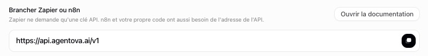

import ApiKey from "/snippets/api-key.mdx";

## 1. Créer une clé API dans Agentova

<ApiKey />

## 2. Créer l'identifiant dans n8n

<Steps>
  <Step title="Credentials → Add credential → Agentova API" />
  <Step title="Remplissez les deux champs">
    | Champ | Valeur |
    |---|---|
    | **Access Token** | Votre clé, `agk_live_…` |
    | **Base URL** | `https://api.agentova.ai/v1`, sauf si Agentova vous communique une autre adresse. Elle est aussi affichée, prête à copier, dans l'encadré **Brancher Zapier ou n8n** de **Paramètres → API** |

    <Frame caption="L'adresse de l'API, prête à copier">
      
    </Frame>

  </Step>
  <Step title="Enregistrez (Save)">
    n8n teste la clé aussitôt. Le message **Connection tested successfully** signifie que tout est prêt.
  </Step>
</Steps>

<Tip>
  Une clé = un espace de travail. Pour plusieurs espaces de travail, créez un identifiant par espace et choisissez le bon dans chaque nœud.
</Tip>

## Si le test échoue

| Message | Ce que cela signifie | Que faire |
|---|---|---|
| « Invalid or revoked Agentova API key… » | La clé est fausse, incomplète ou révoquée | Collez la clé à nouveau, ou créez-en une nouvelle |
| « This Agentova workspace has no access to the API… » | La clé est valide, mais l'abonnement de l'espace de travail est impayé, en pause ou incomplet | Régularisez l'abonnement dans **Paramètres → Abonnement** (votre formule) ou **Paramètres → Facturation** (moyen de paiement, factures) |
| « No Agentova API at this Base URL… » | La Base URL est fausse | Remettez `https://api.agentova.ai/v1` |
| Une erreur de connexion (`ENOTFOUND`, `ECONNREFUSED`…) | Votre n8n n'arrive pas à joindre l'API Agentova | Vérifiez la Base URL et l'accès Internet de votre n8n |
| « Agentova rate limit reached… », « Agentova internal error… » ou « The Agentova API is temporarily unavailable… » | Un problème temporaire côté Agentova | Relancez le test un peu plus tard |

## Quand vous révoquez une clé

Le nœud **Agentova** s'arrête aussitôt dans tous les workflows qui utilisent l'identifiant : chaque opération échoue avec « Invalid or revoked Agentova API key » tant que vous n'avez pas mis à jour l'identifiant avec une nouvelle clé.

Pour un **Agentova Trigger** actif, tout dépend de la case cochée par défaut dans la fenêtre **Révoquer cette clé ?**, qui supprime les abonnements webhook créés avec la clé :

- **Case cochée** (par défaut) : l'abonnement du déclencheur est supprimé avec la clé, et le déclencheur ne reçoit plus d'événements. Mettez à jour l'identifiant avec une nouvelle clé, puis **désactivez et réactivez le workflow** : le déclencheur se réenregistre.
- **Case décochée** : le déclencheur continue de recevoir des événements. Pour l'arrêter, mettez à jour l'identifiant avec une nouvelle clé, puis désactivez le workflow — ou supprimez son abonnement dans le tableau **Abonnements webhook** de **Paramètres → API**.

Voir la révocation d'une clé dans la page [Sécurité](/security).
