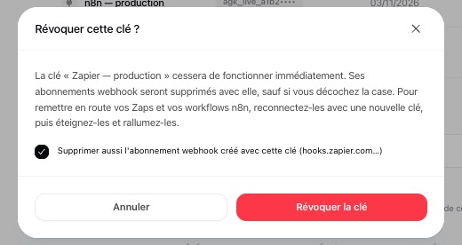

## Clés API

Une clé API — `agk_live_` suivi de 32 caractères — donne accès à **tout l'espace de travail** : ses automatisations, ses leads, ses exécutions et ses abonnements webhook. La v1 n'a ni permissions par clé ni clés de test : chaque clé est une clé réelle.

Agentova ne conserve qu'une empreinte de chaque clé. Une clé s'affiche une seule fois, à sa création, et ne peut plus être réaffichée : si elle est perdue, créez-en une nouvelle.

### Conserver une clé

- Gardez-la sur un serveur : dans un gestionnaire de secrets ou une variable d'environnement. Jamais dans le code source, un dépôt, une URL ou un journal.
- Ne la mettez jamais dans une page web ou une application mobile. L'API n'accepte pas les appels depuis un navigateur (pas de CORS), et tout ce qui est livré sur un appareil peut être lu.
- Envoyez-la uniquement dans l'en-tête `Authorization: Bearer`, vers `https://api.agentova.ai/v1`.
- Créez une clé par outil ou par intégration (« Zapier », « n8n », « Synchro CRM »…), pour pouvoir en révoquer une sans casser les autres.

### Remplacer une clé

Un espace de travail peut avoir jusqu'à 10 clés actives : une clé peut donc être remplacée sans interruption.

1. Créez une nouvelle clé dans **Paramètres → API**.
2. Mettez-la partout où l'ancienne clé est utilisée : reconnectez le compte dans Zapier, mettez à jour l'identifiant (credential) dans n8n, mettez à jour vos serveurs.
3. Réenregistrez vos déclencheurs sous la nouvelle clé : désactivez puis réactivez chaque Zap et chaque workflow n8n qui utilise un déclencheur Agentova.
4. Révoquez l'ancienne clé, en laissant cochée la case qui supprime ses abonnements webhook — voir ci-dessous.

### Révoquer une clé

Une clé révoquée cesse de fonctionner immédiatement : tout appel fait avec elle est refusé avec `401 invalid_api_key`.

Quand vous cliquez sur **Révoquer** sur une clé, la fenêtre de confirmation **Révoquer cette clé ?** affiche une case, cochée par défaut, lorsque des abonnements webhook ont été créés avec cette clé : **Supprimer aussi les abonnements webhook créés avec cette clé** ; son libellé donne leur nombre et les serveurs vers lesquels ils pointent.

<Frame caption="Révoquer une clé : la case est cochée par défaut">
  
</Frame>

- **Case cochée** (par défaut) : les abonnements sont supprimés en même temps que la clé. Une clé qui a fuité a pu abonner le serveur de quelqu'un d'autre : dès lors, il ne reçoit plus rien. Les Zaps et les workflows n8n qui utilisaient ces abonnements ne reçoivent plus d'événements ; une fois passés sur une nouvelle clé, désactivez puis réactivez le Zap, ou désactivez puis réactivez le workflow, pour les réenregistrer.
- **Case décochée** : les abonnements sont conservés et continuent de recevoir les événements de votre espace de travail, **tant que l'administrateur qui a créé la clé reste administrateur de l'espace de travail**. S'il le quitte ou perd ce rôle, ces abonnements cessent de recevoir des événements, sans alerte, même s'ils apparaissent encore dans le tableau **Abonnements webhook**. Pour remplacer une clé durablement, réenregistrez plutôt vos déclencheurs sous la nouvelle clé (voir [Remplacer une clé](#remplacer-une-clé)).

Les administrateurs de l'espace de travail voient tous les abonnements dans le tableau **Abonnements webhook** de **Paramètres → API**, avec la clé qui a créé chacun, et peuvent les y supprimer.

<Warning>
  Si une clé a pu fuiter : révoquez-la avec la case cochée, puis vérifiez le tableau **Abonnements webhook** de **Paramètres → API** et supprimez les abonnements que vous ne reconnaissez pas.
</Warning>

### Quand un administrateur part

Seuls les administrateurs peuvent créer des clés. Quand l'administrateur qui a créé une clé quitte l'espace de travail, en est retiré, supprime son compte ou cesse d'être administrateur, ses clés actives sont révoquées automatiquement, avec les abonnements webhook créés avec elles, et les autres administrateurs sont prévenus. Les abonnements conservés d'une clé qu'il avait déjà révoquée (case décochée) cessent eux aussi de recevoir des événements. Si une intégration s'arrête avec `401 invalid_api_key` après un tel changement, créez une nouvelle clé et reconnectez-la.

## Webhooks

- Chaque livraison est signée avec le secret de l'abonnement (`whsec_…`, affiché une seule fois, à la création). Vérifiez la signature de chaque livraison, et rejetez les livraisons signées il y a plus de 5 minutes — voir [Vérifier la signature](/guides/webhooks-and-signatures#vérifier-la-signature).
- Authentifiez les livraisons par la signature. Pas par adresse IP — Agentova ne publie pas de liste d'adresses d'origine — ni par leur en-tête `User-Agent: Agentova-Webhooks/1.0`, que n'importe qui peut envoyer : il ne sert qu'à vous aider à repérer les livraisons dans vos journaux.
- Les livraisons ne partent que vers des adresses HTTPS publiques, et les redirections ne sont jamais suivies. Un abonnement dont l'URL ne passe plus ces contrôles d'adresse — par exemple une adresse IP devenue interdite — est désactivé immédiatement, sans aucune livraison, et les administrateurs de l'espace de travail sont prévenus.
- Pour changer le secret d'un abonnement, créez un nouvel abonnement, passez votre route sur le nouveau secret, puis supprimez l'ancien abonnement. Tant que les deux existent, le même événement parvient aux deux, avec le même `id` : dédoublonnez sur lui.

## Appels depuis un navigateur

L'API fonctionne de serveur à serveur. Elle n'envoie pas d'en-têtes CORS, et la requête préalable (`OPTIONS`) d'un navigateur reçoit une erreur au format habituel. Appelez l'API depuis votre backend, et gardez-y la clé.

## Essayer l'API depuis ce portail

Le bac d'essai de l'onglet **Référence de l'API** envoie vos requêtes par le proxy de Mintlify, le service qui héberge ce portail, puisque l'API n'accepte pas les appels depuis un navigateur. La clé que vous y collez passe par ce proxy. Préférez une clé créée pour l'occasion, dans un espace de travail de test, et révoquez-la ensuite.

## Conservation des données

| Donnée | Conservée |
|---|---|
| Exécutions | 90 jours, puis supprimées |
| Journal des livraisons de webhook | 30 jours, puis supprimé |
| Abonnements webhook désactivés | 30 jours après leur désactivation, puis supprimés |

Les clés commençant par `_` dans les `custom_fields` d'un lead sont internes à Agentova et ne sont jamais exposées par l'API.

## Signaler une vulnérabilité

Écrivez à [contact@agentova.ai](mailto:contact@agentova.ai) en donnant ce qu'il faut pour reproduire le problème. N'incluez jamais une vraie clé API ni un vrai secret de webhook : décrivez le problème, ou utilisez une clé que vous révoquez juste après.
