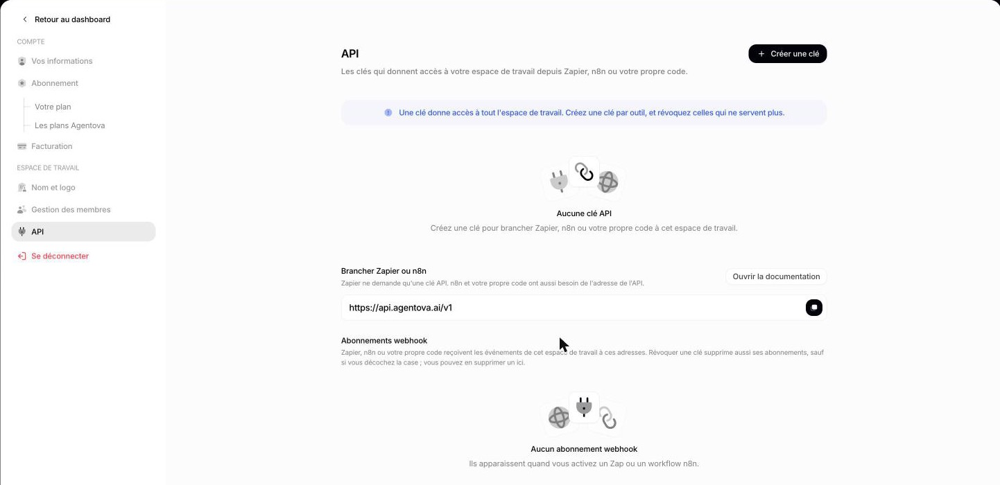
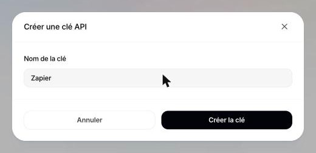
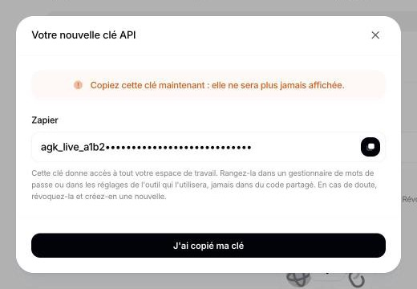

<Steps>
  <Step title="Open Paramètres → API in Agentova">
    The Agentova app is in French: the screen is **Paramètres → API** (Settings → API), in the **ESPACE DE TRAVAIL** section of the settings. You need to be an **admin** of the workspace: other members can open the page, but can't create or revoke keys.

    <Frame caption="Paramètres → API, before the first key">
      
    </Frame>

  </Step>
  <Step title="Create a key and copy it right away">
    Click **Créer une clé** (Create a key), give it a name that says where it's used, for example “Zapier — marketing team”, and confirm with **Créer la clé**. The key looks like `agk_live_…` and is **shown only once**: copy it, then close the window with **J'ai copié ma clé** (I've copied my key).

    <Frame caption="Name the key after the tool that will use it">
      
    </Frame>

    <Frame caption="The key is shown once: copy it with the button on the right (masked here)">
      
    </Frame>

  </Step>
  <Step title="Keep it secret">
    One key gives access to the **whole workspace**: listing its automations, pausing and reactivating them, reading its leads and runs, managing its webhook subscriptions. Every admin of the workspace is notified when a key is created. You can have up to 10 active keys; revoke the ones you no longer use.
  </Step>
</Steps>

A revoked key stops working immediately, everywhere it's used. By default, the webhook subscriptions created with it are deleted with it, so the triggers that rely on them stop receiving events — see [Security](/security#revoking-a-key).
