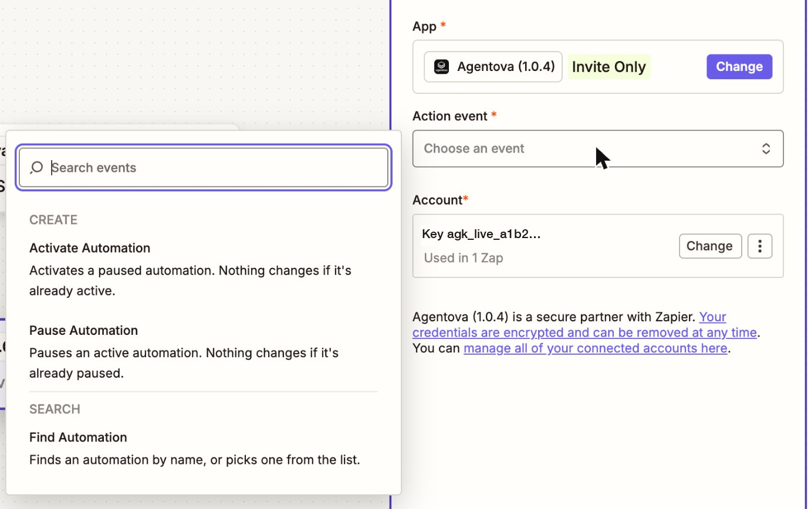

import PauseBehavior from "/snippets/pause-behavior.mdx";

## Activate Automation et Pause Automation

**Activate Automation** réactive une automatisation en pause ; **Pause Automation** met en pause une automatisation active. Les deux n'ont qu'un champ :

| Champ | Ce qu'il faut y mettre |
|---|---|
| **Automation** | Choisissez l'automatisation dans la liste, ou insérez son ID (`aut_…`) issu d'une étape précédente — par exemple le résultat d'une étape **Find Automation**. |

<Frame caption="Les actions et la recherche d'Agentova, au choix de l'événement d'une étape d'action">
  
</Frame>

L'étape renvoie l'automatisation avec son statut **après** le changement. Si Agentova n'a pas pu appliquer le statut — par exemple, l'automatisation n'a pas pu être réactivée et elle est maintenant en erreur — l'étape échoue avec un message qui le dit, au lieu d'afficher une réussite.

<PauseBehavior />

## Find Automation

Retrouve une automatisation pour qu'une étape suivante puisse l'utiliser.

| Champ | Ce qu'il faut y mettre |
|---|---|
| **Automation** | Choisissez l'automatisation dans la liste, ou insérez son ID issu d'une étape précédente. Quand ce champ est renseigné, **Name** est ignoré. |
| **Name** | Le nom de l'automatisation. Une correspondance exacte (sans tenir compte des majuscules) passe en premier ; sinon, l'automatisation la plus récemment créée dont le nom contient le texte. |

Les noms d'automatisations se lisent « *ce que fait l'automatisation* — *nom de l'agent* », par exemple « Comment replies — Support Agent », « Email replies — Support Agent » ou « Lead Ads — Support Agent », et pour une source CRM « HubSpot contacts — Support Agent ». Les noms des automatisations de messagerie ne contiennent pas le canal : chercher « Instagram » ne trouve rien. Et un même agent sur deux canaux donne deux automatisations portant le même nom.

<Tip>
  Pour toujours viser la même automatisation, **choisissez-la dans la liste ou utilisez son ID**. Si vous cherchez par nom, copiez le nom exact depuis l'application Agentova.
</Tip>

## Erreurs possibles

| Message | Pourquoi | Que faire |
|---|---|---|
| « Automation not found in this Agentova workspace… » | L'automatisation a été supprimée ou désactivée dans Agentova, son compte a été déconnecté, ou elle appartient à un autre espace de travail | Choisissez de nouveau l'automatisation dans la liste |
| « This automation is a draft… » ou « This automation is in error… » | Les brouillons et les automatisations en erreur ne peuvent pas être basculés depuis un Zap | Corrigez l'automatisation dans l'application Agentova, puis réessayez |
| « This mailbox is already used by another active Agentova agent… » | Un autre agent actif utilise déjà la boîte mail de cette automatisation d'e-mails : Agentova autorise un seul agent actif par boîte mail | Détachez la boîte mail de l'autre agent dans l'application Agentova, puis réessayez |
| « Agentova couldn't activate this automation: it is now in error… » | L'automatisation n'a pas pu être réactivée, par exemple parce que sa connexion n'a pas pu être rétablie | Vérifiez la connexion de l'automatisation dans l'application Agentova |
| « Agentova's request limit was reached… » | Plus d'environ 100 requêtes par minute avec cette clé | Rien : Zapier fait automatiquement un nouvel essai après le délai |
| « Invalid or revoked API key… » | La clé utilisée par ce compte a été révoquée | Reconnectez le compte avec une nouvelle clé |
| « The Agentova API is temporarily unavailable… » | Agentova a coupé son API pendant un temps | Réessayez plus tard |
