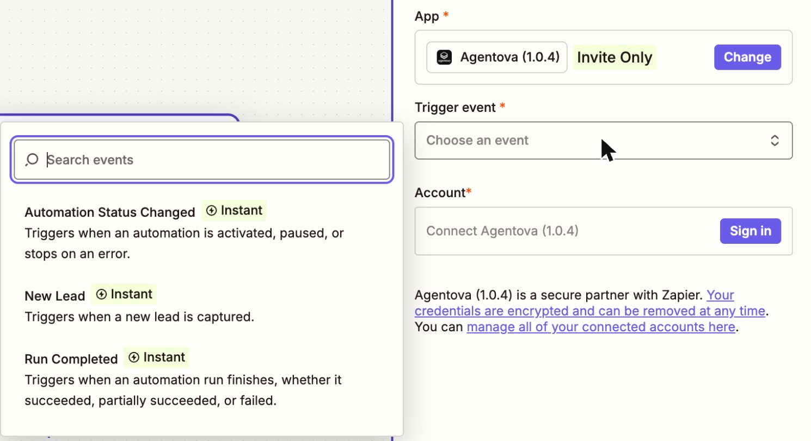
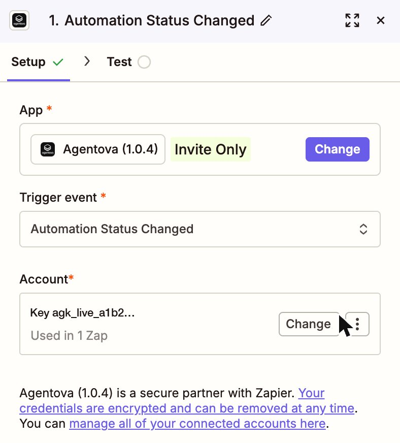
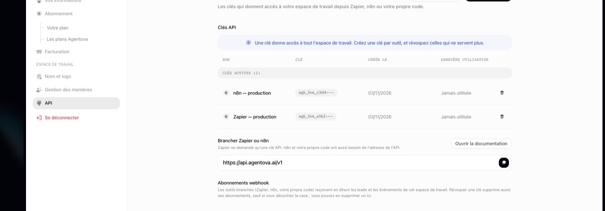

import ApiKey from "/snippets/api-key.mdx";

## 1. Créer une clé API dans Agentova

<ApiKey />

## 2. La connecter dans Zapier

<Steps>
  <Step title="Accepter l'invitation (tant que l'application est sur invitation)">
    Ouvrez le lien d'invitation qu'Agentova vous a envoyé, en étant connecté au compte Zapier que vous allez utiliser, et acceptez-la. Sans cette étape, l'application Agentova n'apparaît pas dans l'éditeur de Zap. Une fois l'application publique, passez cette étape.
  </Step>
  <Step title="Ajouter une étape Agentova à un Zap">
    Dans l'éditeur de Zap, ajoutez un déclencheur ou une action et cherchez **Agentova**. Choisissez l'événement voulu.

    <Frame caption="L'application Agentova dans l'éditeur de Zap : ses trois déclencheurs instantanés et le bouton Sign in">
      
    </Frame>

  </Step>
  <Step title="Se connecter">
    Cliquez sur **Sign in** (ou **Connect a new account**) et collez votre clé dans le champ **API key**.
  </Step>
  <Step title="Vérifier la connexion">
    Zapier teste la clé immédiatement. Quand elle fonctionne, le compte est nommé d'après le début de sa clé — par exemple **Key agk_live_a1b2…** — le même début qu'Agentova affiche dans **Paramètres → API**. C'est ainsi que vous savez quelle clé utilise chaque compte Zapier, par exemple avant d'en révoquer une.

    <Frame caption="Le compte connecté, nommé d'après le début de sa clé">
      
    </Frame>

    <Frame caption="Paramètres → API affiche le début de chaque clé : celui-là même que Zapier utilise pour nommer le compte connecté">
      
    </Frame>

  </Step>
</Steps>

<Tip>
  Une clé = un espace de travail. Pour travailler avec plusieurs espaces de travail Agentova, connectez un compte par espace de travail, chacun avec sa propre clé.
</Tip>

## Si la connexion échoue

| Message | Ce que ça veut dire | Que faire |
|---|---|---|
| « Invalid or revoked API key… » | La clé est fausse, incomplète, ou a été révoquée | Copiez de nouveau la clé, ou créez-en une nouvelle |
| « Your Agentova subscription doesn't currently allow API access… » | L'abonnement de l'espace de travail est impayé, en pause ou incomplet | Régularisez l'abonnement dans **Paramètres → Abonnement** (votre formule) ou **Paramètres → Facturation** (moyen de paiement, factures) |

## Quand vous révoquez une clé

Les **actions et recherches** Agentova qui utilisent la clé s'arrêtent : Zapier marque le compte comme expiré, vous prévient par e-mail, et met en attente les exécutions de ces Zaps jusqu'à ce que vous reconnectiez le compte avec une nouvelle clé.

Les **déclencheurs** Agentova dépendent de la case cochée par défaut dans la fenêtre **Révoquer cette clé ?**, qui supprime les abonnements webhook créés avec la clé :

- **Case cochée** (par défaut) : les inscriptions des Zaps sont supprimées avec la clé, et leurs déclencheurs ne reçoivent plus d'événements. Une fois le compte reconnecté avec une nouvelle clé, **désactivez puis réactivez chaque Zap** pour qu'il s'inscrive de nouveau.
- **Case décochée** : les déclencheurs continuent de recevoir les événements, tant que l'administrateur qui a créé l'ancienne clé reste administrateur de l'espace de travail. Pour ne plus en dépendre, désactivez puis réactivez chaque Zap une fois le compte reconnecté avec la nouvelle clé. Pour les arrêter plus tard, désactivez leurs Zaps, ou supprimez leurs abonnements dans le tableau **Abonnements webhook** de **Paramètres → API**.

Voir [Révoquer une clé](/security).
